# 📘 Laporan Praktikum Pertemuan Ke - 7

🧑‍🎓 Kholil Irsyad Marwan - 4524210110

# 📚 Book Management System (AuthBook - Multi Role & Category)

Aplikasi manajemen buku, penulis, dan kategori berbasis web dengan multi-role access (Admin, Staff, User) yang dibangun menggunakan Laravel 11 dan Filament v3 Admin Panel untuk Praktikum 7 Pemrograman Berbasis Web.

<p align="center">
  
  
  
  
</p>

## 📋 Daftar Isi

- [🚀 Instalasi & Penggunaan](#-instalasi--penggunaan)
- [📌 Soal & Jawaban Tugas 2](#-soal--jawaban-tugas-2)
- [🎯 Tentang Aplikasi](#-tentang-aplikasi)
- [🎯 Tujuan Praktikum](#-tujuan-praktikum)
- [✨ Fitur Utama](#-fitur-utama)
- [🛠️ Tech Stack](#️-tech-stack)
- [🗄️ Struktur Database](#️-struktur-database)

---

## 🚀 Instalasi & Penggunaan

### 1. Clone Repository
Buka terminal dan jalankan perintah clone untuk mengunduh repositori:
```bash
git clone [https://github.com/KholilIrsyadMarwan/4524210110-KHOLILIRSYADMARWAN-PBW-A-Praktikum7.git](https://github.com/KholilIrsyadMarwan/4524210110-KHOLILIRSYADMARWAN-PBW-A-Praktikum7.git)
cd 4524210110-KHOLILIRSYADMARWAN-PBW-A-Praktikum7/authbook

```
2. Install PHP Dependencies

Instal seluruh pustaka PHP yang dibutuhkan (termasuk Filament v3):

composer install


3. Setup Environment (.env)

Salin file .env.example menjadi .env lalu generate application key:

cp .env.example .env
php artisan key:generate


Catatan Konfigurasi Database (SQLite):

Pastikan di dalam file .env variabel database sudah terkonfigurasi ke SQLite:

DB_CONNECTION=sqlite


4. Setup Database & Seeding Data Dummy

Jalankan migrasi database untuk membuat tabel categories, authors, books, dan users, sekaligus mengisi data dummy dan role default:

php artisan migrate:fresh --seed


5. Membuat Account User / Admin Filament

Buat akun pengguna untuk masing-masing role agar bisa menguji hak akses pada Filament Admin Panel:

php artisan make:filament-user


Input data akun:

Admin Role: admin@example.com | Password: password

Staff Role: staff@example.com | Password: password

User Role: user@example.com | Password: password

6. Jalankan Local Development Server

Jalankan server bawaan Laravel:

php artisan serve


📌 Soal & Jawaban Tugas 2

Tugas 2: Implementasi Multi-Role & Advanced Filament (Nilai: 60)

Implementasikan pengembangannya dengan menyusun manajemen Kategori, otorisasi 3 Hak Akses (Admin, Staff, User) menggunakan Laravel Policy, serta pembuktian screenshot untuk setiap role.

💡 Jawaban Bukti Implementasi (Screenshot):
A. Hak Akses Role Admin (Akses Penuh / Full Control)
Dashboard Admin

#### A. Hak Akses Role Admin (Full Control)

1. **Dashboard Admin**  
   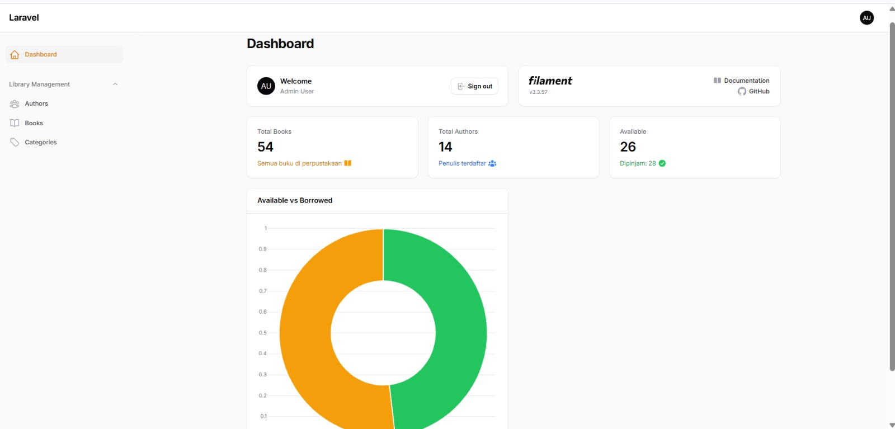

2. **Daftar Buku Admin (Books List)**  
   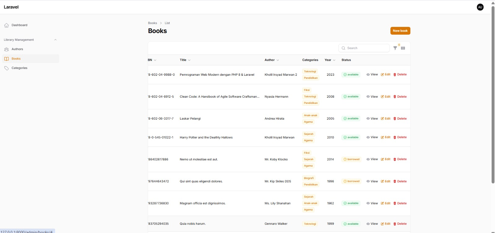

3. **Detail Informasi Buku (View Book Admin)**  
   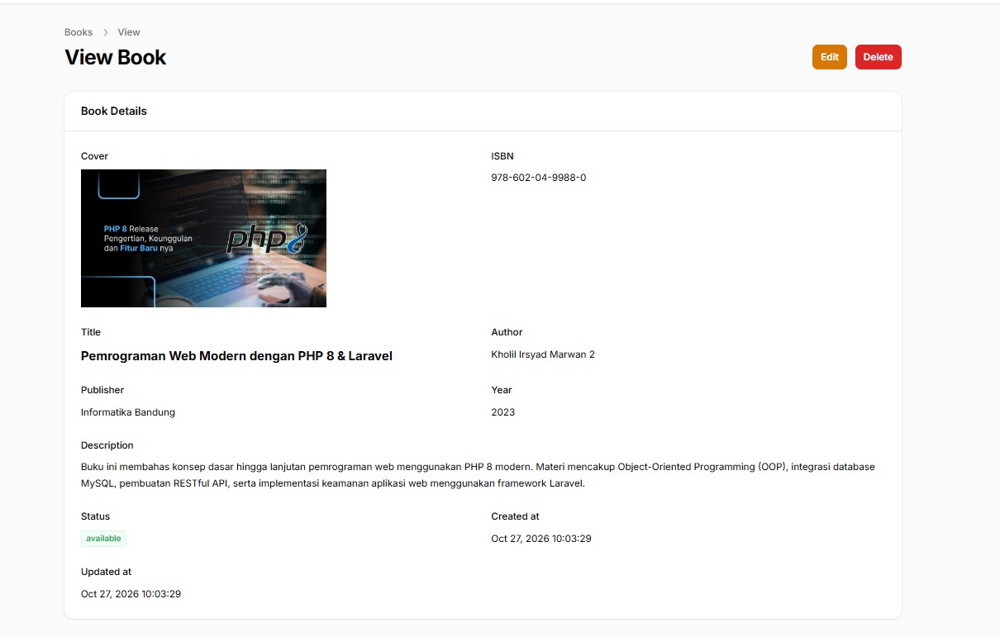

4. **Form Edit Buku (Edit Book Admin)**  
   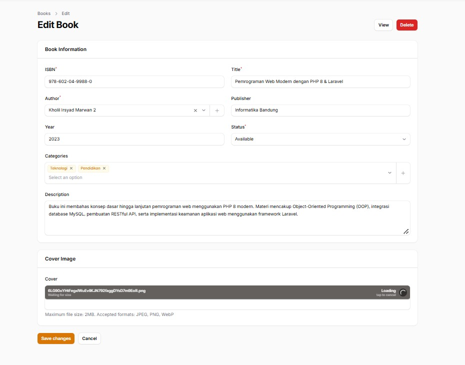

5. **Hapus Data Buku (Delete Book Admin)**  
   

6. **Kelola Data Kategori (Category List Admin)**  
   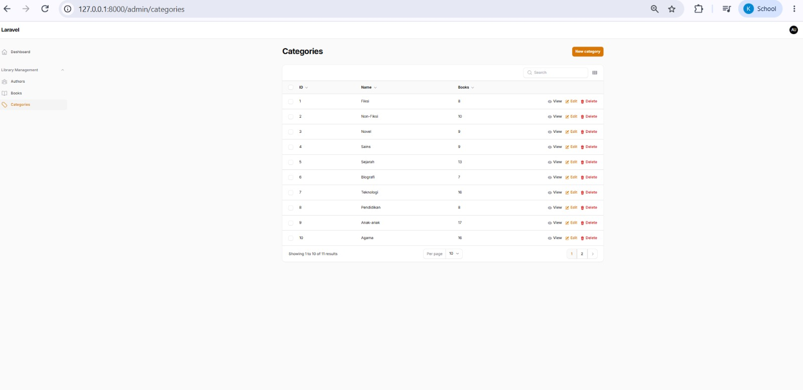

7. **Form Tambah Kategori (Add Category Admin)**  
   

8. **Form Edit Kategori (Edit Category Admin)**  
   

9. **Hapus Data Kategori (Delete Category Admin)**  
   

10. **Kelola Data Penulis (Author List Admin)**  
    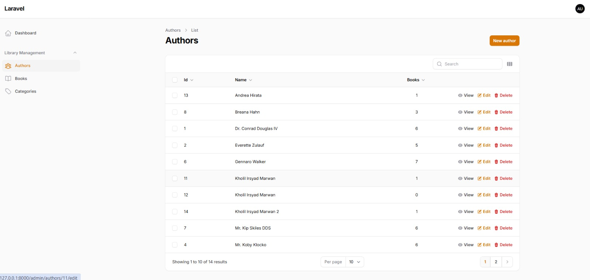

11. **Form Tambah Penulis (Add Author Admin)**  
    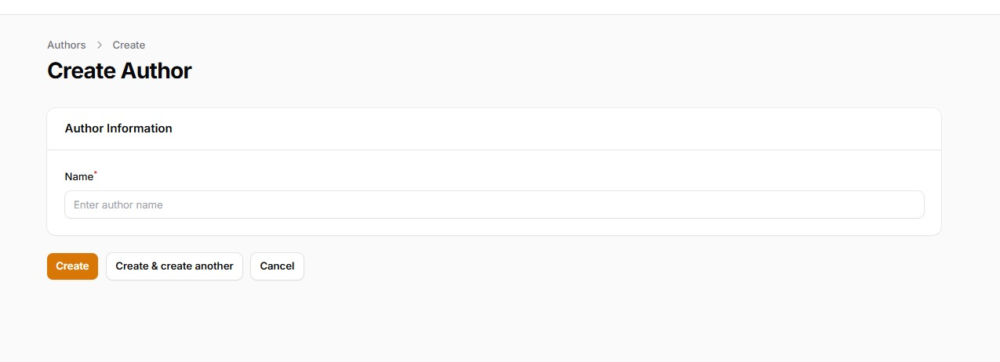

12. **Detail Informasi Penulis (View Author Admin)**  
    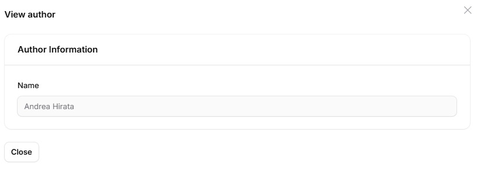

13. **Form Edit Penulis (Edit Author Admin)**  
    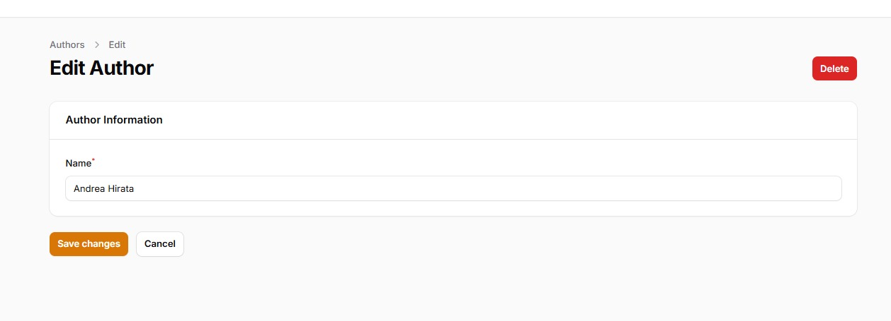

14. **Hapus Data Penulis (Delete Author Admin)**  
    

#### B. Hak Akses Role Staff (Create, Read, Update / Non-Delete)

1. **Dashboard Staff**  
   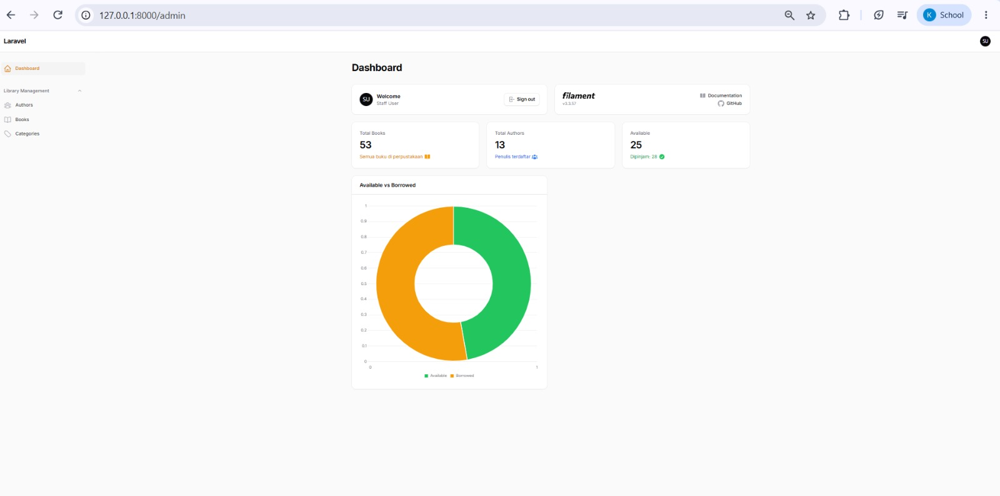

2. **Daftar Buku Staff (Books List)**  
   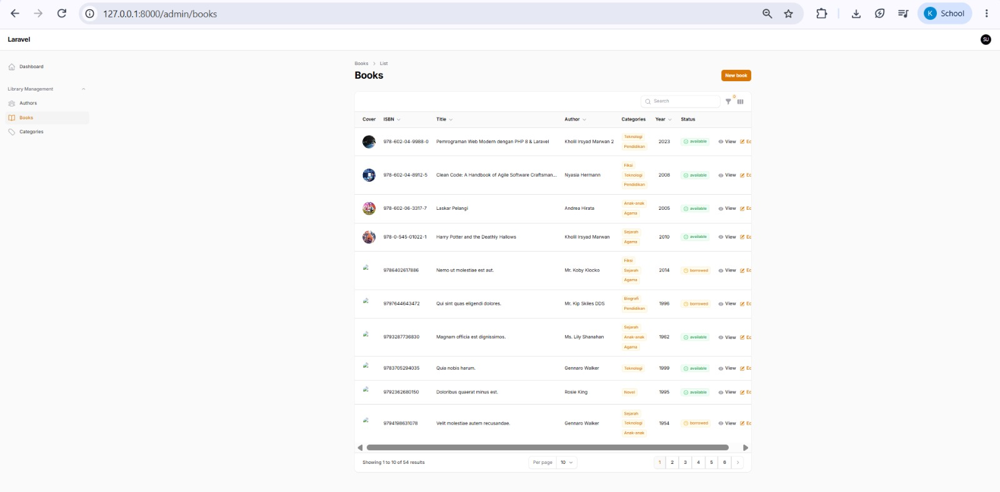

3. **Form Tambah Buku (Create Book Staff)**  
   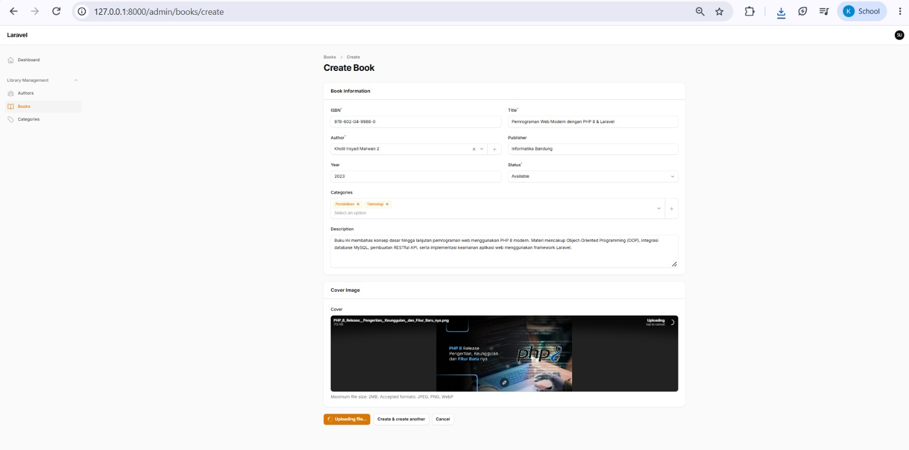

4. **Daftar Kategori Staff (Category List)**  
   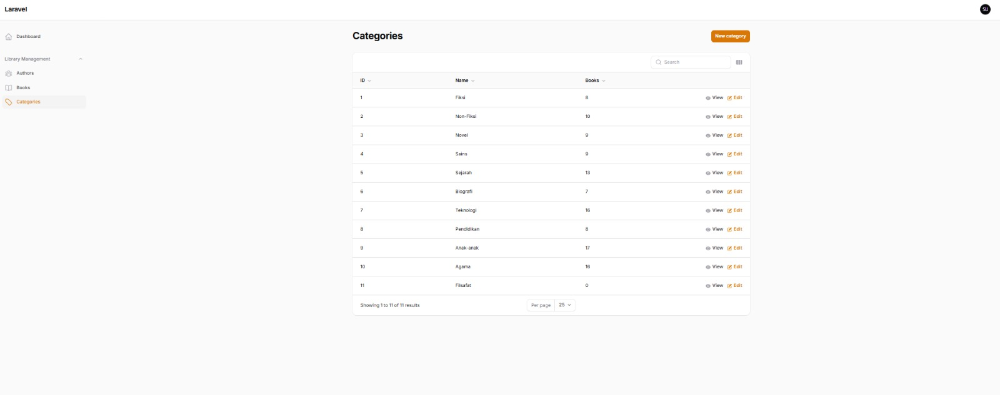

5. **Form Tambah Kategori (Create Category Staff)**  
   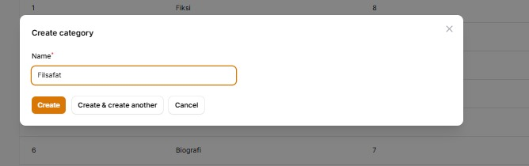

6. **Form Edit Kategori (Edit Category Staff)**  
   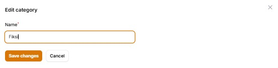

7. **Daftar Penulis Staff (Author List)**  
   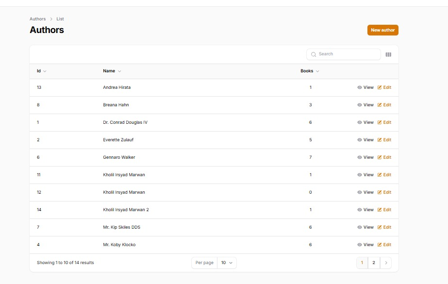

8. **Form Tambah Penulis (Add Author Staff)**  
   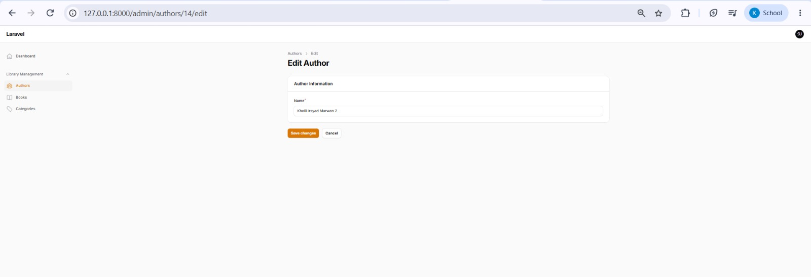

9. **Detail Penulis (View Author Staff)**  
   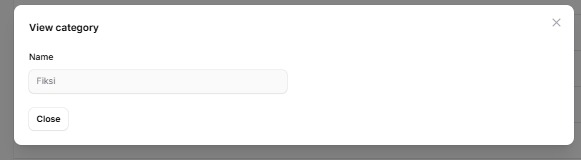

10. **Pencarian Penulis (Search Author Staff)**  
    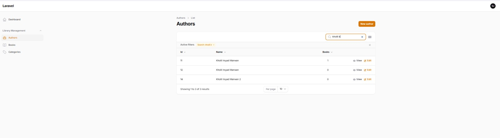

---

#### C. Hak Akses Role User (Read Only)

1. **Daftar Buku User (Books List - Read Only)**  
   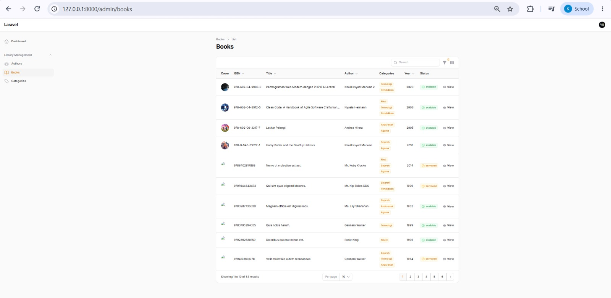

2. **Detail Informasi Buku (View Book User)**  
   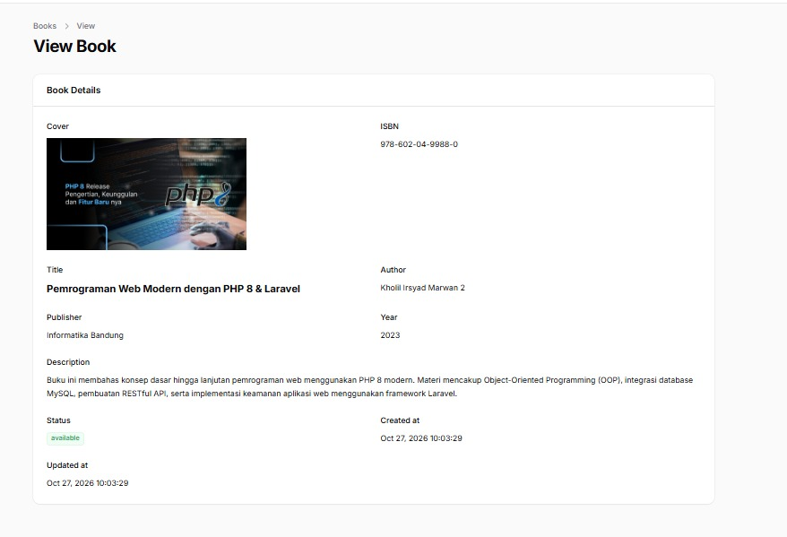

3. **Daftar Kategori User (Category List - Read Only)**  
   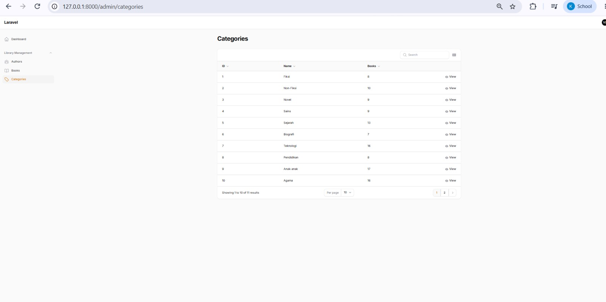

4. **Daftar Penulis User (Author List - Read Only)**  
   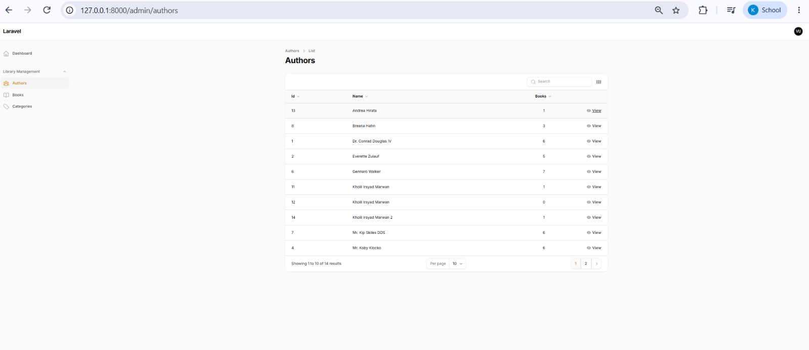

5. **Detail Informasi Penulis (View Author User)**  
   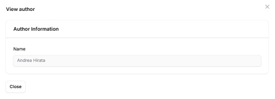

🎯 Tentang Aplikasi

AuthBook versi lanjutan ini dikembangkan sebagai sistem manajemen pustaka digital yang mendukung Multi-Role Access Control dan pengelolaan entitas Kategori Buku. Aplikasi dibangun menggunakan Laravel 11 dan Filament v3, memungkinkan pengaturan otorisasi bertingkat antara Administrator (Admin), Staff, dan Reguler User.

🎯 Tujuan Praktikum

Memahami pengelolaan Multi-Role User pada Filament v3 Admin Panel.

Mengimplementasikan skema database relasional lanjutan (Category HasMany Book, Author HasMany Book).

Menyiapkan pengisian data otomatis (Data Seeding) untuk entitas Kategori, Penulis, Buku, dan Pengguna berdasarkan Role.

Menerapkan pengaturan izin hak akses terpusat menggunakan Laravel Policy untuk mengamankan tindakan Create, Read, Update, dan Delete (CRUD).

✨ Fitur Utama

✅ Multi-Role Authentication & Authorization - Hak akses terbagi menjadi Admin (Akses Penuh), Staff (Create, Read, Update), dan User (Read Only).

✅ Manajemen Category (Kategori) - Fitur pengelolaan kategori buku relasional.

✅ Manajemen Author (Penulis) - Pengelolaan data penulis buku lengkap dengan relasi buku.

✅ Manajemen Book (Buku) - Katalog buku interaktif dilengkapi relasi Kategori, Penulis, ISBN, Cover, Tahun, dan Status.

✅ Search & Filter Table - Fitur pencarian instan dan filter interaktif pada setiap panel tabel.

✅ Policy-Based Control - Keamanan data diatur ketat via Laravel Authorization Policy.

🛠️ Tech Stack

Backend

Laravel 11.x - PHP Framework

PHP ^8.2 - Programming Language

SQLite - Database Storage

Eloquent ORM - Database Management

Admin Panel & Frontend

Filament v3 - Admin Panel Framework

Tailwind CSS - UI Styling Framework

🗄️ Struktur Database

categories: id, name, slug, timestamps

authors: id, name, timestamps

books: id, isbn, title, category_id, author_id, publisher, year, cover, status, timestamps

users: id, name, email, password, role (Admin/Staff/User), timestamps
